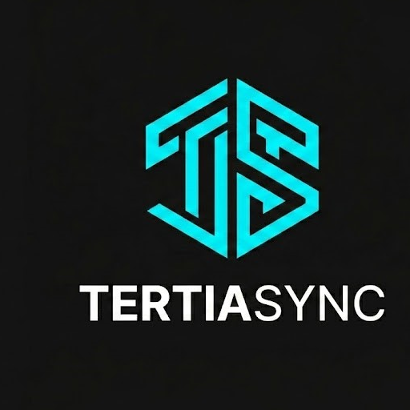
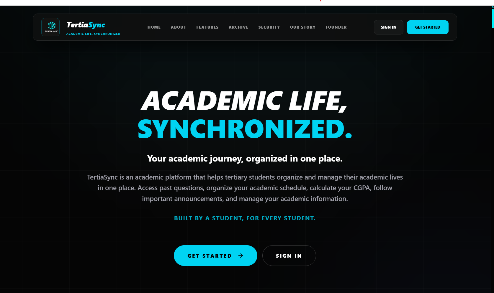
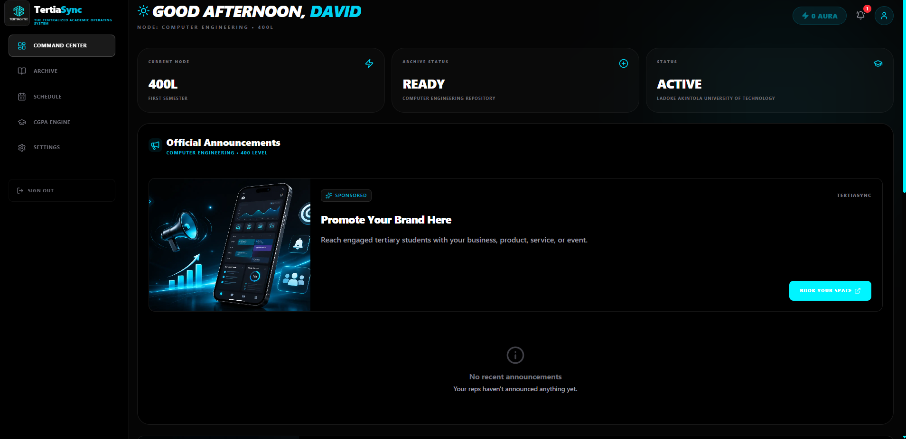
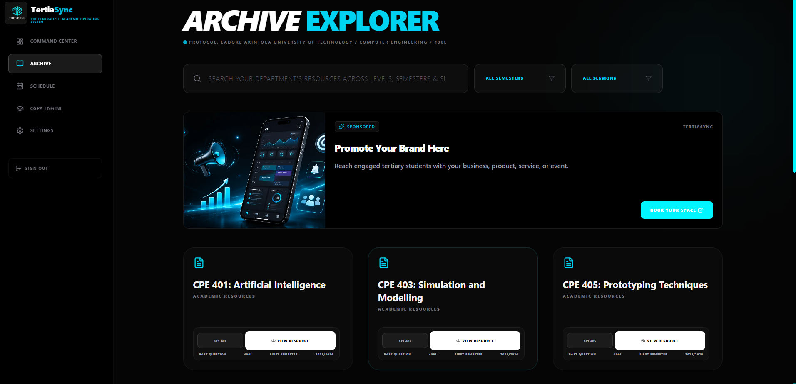
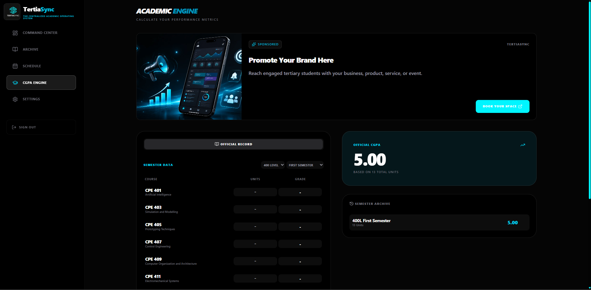
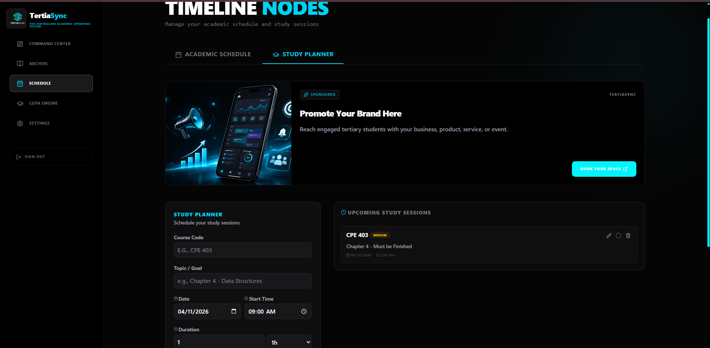

  

<h1 align="center">TertiaSync</h1>

  <strong>Academic Life, Synchronized.</strong>

  A centralized academic technology platform designed to help students
  organize and manage their academic lives.

  <a href="https://tertiasync.com">Official Website</a>

---

## About TertiaSync

TertiaSync is an academic technology platform being developed to help students in Nigerian tertiary institutions organize and manage their academic lives through connected tools and resources.

The project evolved from a past-question initiative started in 2025 and expanded into a broader academic platform in April 2026.

Its long-term vision is to become a standard synchronization layer for Nigerian higher education.

## Product Showcase

### Landing Page

  

### Student Dashboard

  

### Past Question Archive

  

### CGPA Tracker

  

### Study Planner

  

## Key Features

TertiaSync brings together essential academic tools and resources, including:

- **Past Question Archive:** Discover and access academic resources.
- **CGPA Tracking:** Monitor academic performance.
- **Study Planner:** Organize study activities and academic preparation.
- **Community Contributions:** Contribute academic resources to the student community.
- **Progressive Web App:** Access the platform through a web-based, app-like experience.

## Technology Stack

| Area | Technologies |
|---|---|
| Frontend | Next.js, React, TypeScript |
| Backend | Supabase |
| Database | PostgreSQL |
| Authentication | Supabase Auth |
| Storage | Supabase Storage |
| Deployment | Vercel |
| Application Experience | Progressive Web App (PWA) |

## Project Status

**Currently in development.**

TertiaSync is being developed with an initial focus on students at Ladoke Akintola University of Technology (LAUTECH), with plans to support students across Nigerian tertiary institutions.

## Project Vision

To make academic life less scattered by bringing essential academic tools, resources and student activities into one connected platform.

## Founder

**David Godspower Ajala**

Software Developer | Computer Engineering Student | Founder of TertiaSync

- Portfolio: https://davidgodspowerajala.me/
- GitHub: https://github.com/david-godspower
- LinkedIn: https://www.linkedin.com/in/david-godspower-ajala/

---

  <strong>Academic Life, Synchronized.</strong>

